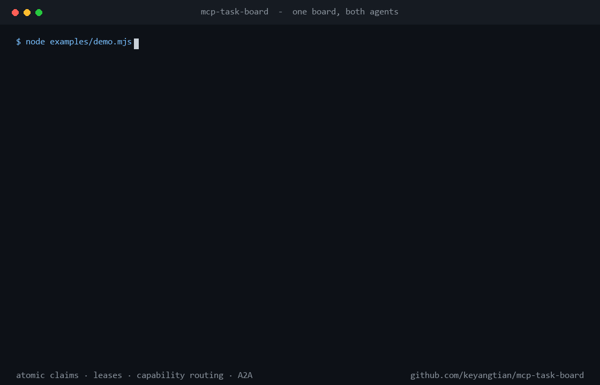

# mcp-task-board

[](https://github.com/keyangtian/mcp-task-board/actions/workflows/ci.yml)
[](LICENSE)
[](package.json)

**Agents don't share a runtime. Give them a board.**



A tiny, dependency-free task board that lives on the filesystem, so *any* agent — a Claude Code session, a WorkBuddy desktop app, a DeepSeek Harness run, a cron script, a Python bot with a shell tool — can pick up work from the same queue.

No server. No database. No shared memory. One directory, atomic claims, leases, dependencies, capabilities.

```
┌────────────┐   post    ┌──────────────────────┐   claim   ┌────────────┐
│  planner   │──────────▶│  tasks/queued/*.json │◀──────────│  worker A  │
│  (any LLM) │           └──────────┬───────────┘           └────────────┘
└────────────┘                      │ rename() — one winner
                                    ▼
                        ┌──────────────────────┐   complete  ┌────────────┐
                        │ tasks/claimed/*.json │────────────▶│ tasks/done │
                        │   lease = 10 min     │             └────────────┘
                        └──────────────────────┘
```

## Why a board instead of "agents talking to each other"

Multi-agent frameworks assume one runtime, one process, one SDK. Your real setup doesn't look like that: the agents are *different products* with different auth, different models, different sandboxes. They cannot import each other, and a message-passing bridge becomes an inbox nobody polls.

A board inverts the flow: the planner only posts, workers pull. That is what production systems converge on once the number of agents exceeds a handful (Claude Code agent teams, Agensh, DeepSeek Harness team tasks all do some version of this), and it is the only coordination mechanism that works when the agents share nothing but a mounted directory.

## Quickstart

```bash
node bin/taskboard.mjs init --agent planner
node bin/taskboard.mjs post --title "Port the CSV exporter" --from planner \
     --cap code --body "Acceptance: tests/export_test.py green; keep the old flag working."
node bin/taskboard.mjs claim --agent worker-a --cap code --json
node bin/taskboard.mjs complete <id> --agent worker-a \
     --summary "ported" --evidence "pytest tests/export_test.py -> 14 passed" \
     --artifact src/export.py
node bin/taskboard.mjs stats
```

Exit code `2` from `claim` means *nothing to do* — handy in a worker loop:

```bash
while true; do
  task=$(mcp-task-board claim --agent worker-a --cap code --json) || sleep 5
  ...work, then: mcp-task-board complete "$id" --agent worker-a --evidence "..."
done
```

## As an MCP server

Any MCP-capable agent gets the board as tools (`board_post`, `board_list`, `board_claim`, `board_renew`, `board_complete`, `board_fail`, `board_show`, `board_stats`, `board_reap`, `agent_register`, `agent_list`):

```json
{
  "mcpServers": {
    "mcp-task-board": {
      "command": "node",
      "args": ["/absolute/path/to/mcp-task-board/bin/taskboard.mjs", "mcp"],
      "env": { "TASKBOARD_HOME": "/absolute/path/to/board", "TASKBOARD_AGENT": "workbuddy" }
    }
  }
}
```

The board home is the only shared thing the agents need; put it on a network share if they run on different machines.

## As an A2A endpoint

Remote agents that cannot see the directory can still delegate: the adapter maps one A2A task to one board task, so the claim/lease/completion semantics stay on the board.

```bash
node bin/taskboard.mjs a2a --agent dsh --port 7801            # card at /.well-known/agent-card.json
node bin/taskboard.mjs a2a --agent dsh --token "$A2A_TOKEN"   # require a bearer token
```

- `GET /.well-known/agent-card.json` — v1.0 card, `capabilities.streaming: true`, one `task-board` skill, JSON-RPC interfaces advertised at both `1.0` and `0.3`.
- JSON-RPC `message/send`, `message/stream`, `tasks/get`, `tasks/cancel`, `tasks/resubscribe`; the v1.0 PascalCase spellings (`SendMessage`, …) are accepted too, because most shipped clients still send the 0.3 lowercase names.
- REST variants: `POST /message:send`, `POST /message:stream`, `GET /tasks/<id>`, `POST /tasks/<id>/cancel`.
- State mapping: `queued → TASK_STATE_SUBMITTED`, `claimed → TASK_STATE_WORKING`, `done → TASK_STATE_COMPLETED`, `failed → TASK_STATE_FAILED`, `cancelled → TASK_STATE_CANCELED`. A finished task's summary, evidence and artifact refs come back as one artifact.
- `message/send` blocks until the task finishes or the client sets `configuration.blocking: false`; `message/stream` follows the task over SSE and ends with `final: true`.
- Push notifications are not implemented (the card says so, and the operation returns an error rather than pretending).

Details, limits and a client example: [docs/A2A.md](docs/A2A.md).

## What it guarantees

- **Exactly one claimant.** Claims are a `rename()` of the task file; the filesystem decides the winner. Tested with 12 racing processes and 6 tasks.
- **Blocked work is unreachable.** `blockedBy` tasks must be `done` before a claim succeeds.
- **Capabilities are enforced.** A task requiring `deploy` cannot be taken by an agent with only `read` — unlike availability-only self-claim, which is a known failure mode of agent teams.
- **Dead owners don't strand work.** Every claim carries a lease; `reap` returns expired leases to the queue, and a task that keeps dying lands in `failed` after `maxAttempts`.
- **Ping-pong is bounded.** Replies carry `reply_to` and a hop counter; past `maxHops` the post is rejected.
- **Artifacts stay on disk.** `complete --artifact` stores a path, size and sha256, never the bytes.
- **Everything is auditable.** Every transition appends one JSON line to `events.jsonl`.

## What it is not

- **Not an orchestrator.** It never calls a model, never plans, never guesses. The planner is an agent; the board is where its plan lands.
- **Not a message bus.** No chat history, no context sharing. Agents exchange *tasks and artifact references*, which is what Anthropic's own write-up recommends to avoid the game of telephone.
- **Not a database.** Filesystem semantics, one board per host or mounted share. See [docs/DESIGN.md](docs/DESIGN.md) for the assumptions and failure modes.

## Commands

| Command | Purpose |
|---|---|
| `post` | add a task (`--cap`, `--blocked-by`, `--reply-to`, `--client-token` for idempotency) |
| `list` / `show` | inspect the board |
| `claim` | atomically take one task (exit `2` if none) |
| `renew` | heartbeat the lease while working |
| `complete` / `fail` | close the task with evidence and artifact refs |
| `cancel` | withdraw a task (from a human) |
| `reap` | return expired leases (run from cron/timer) |
| `stats` / `events` | health and audit trail |
| `agents register` / `agents list` | capability cards |
| `mcp` | run as an MCP stdio server |
| `a2a` | run an A2A server (`--port`, `--host`, `--public-url`, `--token`) |

## Works with

Anything that can run a shell or speak MCP: Claude Code, WorkBuddy / CodeBuddy, DeepSeek Harness, OpenAI Agents SDK, LangGraph, CrewAI, a Python daemon, `cron`, or a second machine over a network drive. See [examples/dsh-workbuddy.md](examples/dsh-workbuddy.md) for a two-desktop-app setup.

## Related work (and what is different)

Several projects put a board in front of agents: [sugar](https://github.com/roboticforce/sugar) (local-first queue with leases and an MCP server), [agent-kanban](https://github.com/saltbo/agent-kanban), [guild](https://github.com/mathomhaus/guild) (single Go binary, SQLite), [agent-teams-ai](https://github.com/777genius/agent-teams-ai) (Electron "company" with a kanban), and DSH's own `agent-team` (roster + shared DAG).

This one is deliberately narrow, and the narrow part is the point:

- **Capability routing is enforced at claim time**, not just "who is idle takes it". The most common failure mode of agent teams is a read-only worker claiming a task that needs write access.
- **Artifacts are references + sha256**, never inline. Other boards pass task text and burn tokens on payloads; the board keeps its hands off the bytes.
- **Zero runtime dependencies, no database, no daemon.** Four source files, ~1,500 lines, `node >= 18`, a directory. It runs from a USB stick, on Windows, on a mounted share, on a locked-down box where you cannot install SQLite.
- **Claim refusal reasons are ranked**, so a worker loop can tell "work is blocked" from "I am not the right agent" without parsing prose.
- **Remote delegation without a shared disk**: the same board is an A2A endpoint, so a client that only speaks HTTP can post a task and collect the artifact.

If you already run sugar, keep it and use this board only for the capability-routed, cross-vendor case; the task format is plain JSON on purpose.

## Roadmap

- Push notifications (webhooks) on the A2A endpoint; today it is poll/stream only and the card says so.
- Multi-tenant contexts: one A2A server in front of several boards.
- Signed task envelopes for untrusted peers.

MIT licensed. Node ≥ 18, zero dependencies.
