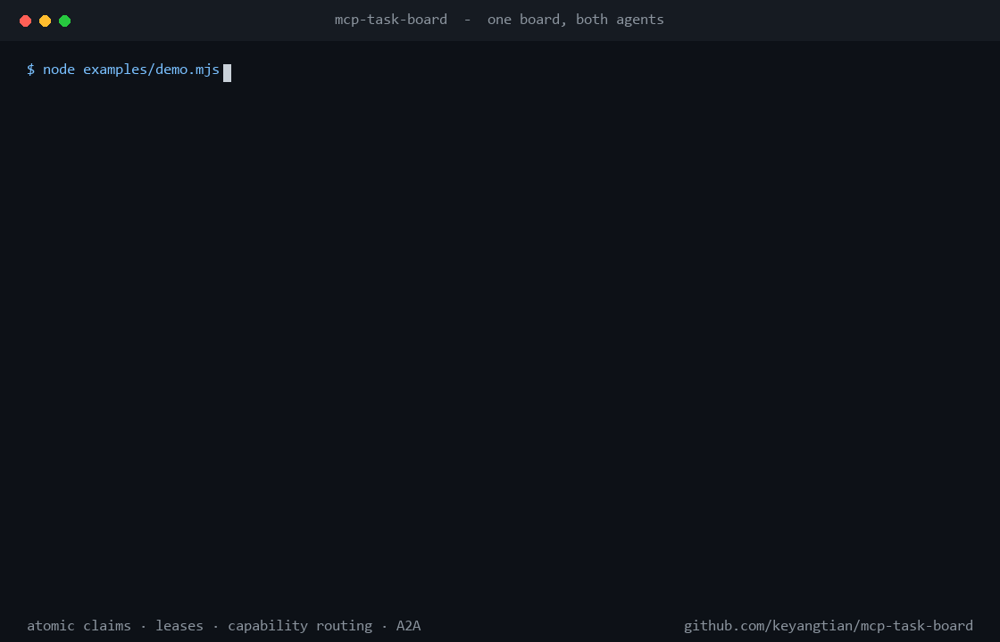

# mcp-task-board

[](https://github.com/keyangtian/mcp-task-board/actions/workflows/ci.yml)
[](LICENSE)
[](package.json)

**智能体不共享运行时，那就给它们一块板。**



一块长在文件系统上的任务板，零依赖：Claude Code、WorkBuddy、DeepSeek Harness、定时脚本、带 shell 的 Python 机器人…… 任何智能体都能从同一条队列里领活。

不用服务器，不用数据库，不用共享记忆。就是一个目录 + 原子认领 + 租约 + 依赖 + 能力约束。

```
┌────────────┐   投递    ┌──────────────────────┐   认领    ┌────────────┐
│   规划者   │──────────▶│ tasks/queued/*.json  │◀──────────│  工人 A    │
│  (任意模型)│           └──────────┬───────────┘           └────────────┘
└────────────┘                      │ rename() —— 只有一个赢家
                                    ▼
                        ┌──────────────────────┐   完成      ┌────────────┐
                        │ tasks/claimed/*.json │────────────▶│ tasks/done │
                        │   租约 = 10 分钟      │             └────────────┘
                        └──────────────────────┘
```

## 为什么用板，而不是让智能体直接互相对话

多智能体框架都假设"一个运行时、一个进程、一个 SDK"。但真实的多个智能体是**不同产品**：登录态不同、模型不同、沙箱不同，互相 import 不了；靠消息管道对接，最后往往变成没人去收的收件箱。

板把方向反过来：规划者只投递，工人自己来领。智能体数量一多，生产系统几乎都会滑向这个形态（Claude Code 的 agent teams、Agensh、DeepSeek Harness 的 team tasks 都是这个思路的变体），而且这是唯一在"除了目录什么都不共享"时仍然成立的做法。

## 30 秒上手

```bash
node bin/taskboard.mjs init --agent planner
node bin/taskboard.mjs post --title "迁移 CSV 导出器" --from planner \
     --cap code --body "验收：tests/export_test.py 全绿；旧参数保持兼容。"
node bin/taskboard.mjs claim --agent worker-a --cap code --json
node bin/taskboard.mjs complete <id> --agent worker-a \
     --summary "已迁移" --evidence "pytest tests/export_test.py -> 14 passed" \
     --artifact src/export.py
node bin/taskboard.mjs stats
```

`claim` 返回退出码 `2` 表示"没活"，方便写循环：

```bash
while true; do
  task=$(mcp-task-board claim --agent worker-a --cap code --json) || sleep 5
  ...干完：mcp-task-board complete "$id" --agent worker-a --evidence "..."
done
```

## 作为 MCP 服务用

任何支持 MCP 的智能体都能直接把板当工具（`board_post` / `board_list` / `board_claim` / `board_renew` / `board_complete` / `board_fail` / `board_show` / `board_stats` / `board_reap` / `agent_register` / `agent_list`）：

```json
{
  "mcpServers": {
    "mcp-task-board": {
      "command": "node",
      "args": ["/绝对路径/mcp-task-board/bin/taskboard.mjs", "mcp"],
      "env": { "TASKBOARD_HOME": "/绝对路径/board", "TASKBOARD_AGENT": "workbuddy" }
    }
  }
}
```

板目录是智能体唯一需要共享的东西；跨机器就放到共享盘上。

## 作为 A2A 端点用

看不到目录的远端智能体也能派活：适配层把「一个 A2A 任务」映射成「一个板任务」，认领、租约、结案这些语义仍然只存在于板上。

```bash
node bin/taskboard.mjs a2a --agent dsh --port 7801            # 卡片在 /.well-known/agent-card.json
node bin/taskboard.mjs a2a --agent dsh --token "$A2A_TOKEN"   # 要求 Bearer token
```

- `GET /.well-known/agent-card.json`：v1.0 卡片，`capabilities.streaming: true`，一个 `task-board` 技能，JSON-RPC 接口同时声明 `1.0` 与 `0.3`。
- JSON-RPC：`message/send`、`message/stream`、`tasks/get`、`tasks/cancel`、`tasks/resubscribe`；v1.0 的 `SendMessage` 等帕斯卡命名也接受（现网客户端大多还发 0.3 小写名）。
- REST：`POST /message:send`、`POST /message:stream`、`GET /tasks/<id>`、`POST /tasks/<id>/cancel`。
- 状态映射：`queued → TASK_STATE_SUBMITTED`、`claimed → TASK_STATE_WORKING`、`done → TASK_STATE_COMPLETED`、`failed → TASK_STATE_FAILED`、`cancelled → TASK_STATE_CANCELED`；结案摘要、证据、产物引用合成一个 artifact 返回。
- `message/send` 默认阻塞到任务结束；客户端设 `configuration.blocking: false` 变成异步。`message/stream` 用 SSE 跟到底并带 `final: true`。
- 推送通知（webhook）未实现，卡片里如实写 `pushNotifications: false`。

细节、限制和客户端示例见 [docs/A2A.md](docs/A2A.md)。

## 它保证什么

- **只有一个认领者**：认领是对任务文件做 `rename()`，由文件系统裁决胜负（测试里 12 个进程抢 1 个任务、6 个任务 6 个进程各得其一）。
- **依赖没完成就领不到**：`blockedBy` 全部 `done` 之前，认领被拒。
- **能力不匹配领不走**：需要 `deploy` 的任务，只有 `read` 的智能体拿不到——"只看空闲不看能力"是现有 agent teams 的已知翻车点。
- **工人死了活不丢**：每次认领带租约，`reap` 把过期租约放回队列；反复超时的任务在 `maxAttempts` 后进 `failed`。
- **委派不会乒乓**：回复带 `reply_to` 和跳数，超过 `maxHops` 直接拒绝投递。
- **产物留在磁盘上**：`complete --artifact` 只记路径、大小和 sha256，不把内容塞进消息。
- **全程可审计**：每次状态迁移往 `events.jsonl` 追加一行 JSON。

## 它不是什么

- **不是编排器**：不调模型、不做计划。规划是智能体的事，板只负责接住它的计划。
- **不是消息总线**：不共享对话历史，只交换"任务 + 产物引用"——这也是 Anthropic 自己的经验：让子智能体把大产物写文件、只回传引用，避免多级转述失真。
- **不是数据库**：文件系统语义，一块板一个宿主或一个挂载盘。假设与坑见 [docs/DESIGN.md](docs/DESIGN.md)。

## 命令

| 命令 | 用途 |
|---|---|
| `post` | 投递任务（`--cap`、`--blocked-by`、`--reply-to`、`--client-token` 幂等） |
| `list` / `show` | 看板 |
| `claim` | 原子认领一个任务（没有则退出码 `2`） |
| `renew` | 干活期间续租（心跳） |
| `complete` / `fail` | 带证据与产物引用结案 |
| `cancel` | 撤回任务（给人用） |
| `reap` | 回收过期租约（放到 cron/定时器里） |
| `stats` / `events` | 健康度与审计 |
| `agents register` / `agents list` | 能力卡 |
| `mcp` | 以 MCP stdio 服务运行 |
| `a2a` | 以 A2A 服务运行（`--port`、`--host`、`--public-url`、`--token`） |

## 能接谁

只要能跑 shell 或者说 MCP 都行：Claude Code、WorkBuddy / CodeBuddy、DeepSeek Harness、OpenAI Agents SDK、LangGraph、CrewAI、Python 守护进程、`cron`，或者共享盘另一头的第二台机器。两个桌面智能体的接法见 [examples/dsh-workbuddy.md](examples/dsh-workbuddy.md)。

## 同类项目（以及差在哪）

已经有不少项目在给智能体做任务板：[sugar](https://github.com/roboticforce/sugar)（本地优先队列 + 租约 + MCP）、[agent-kanban](https://github.com/saltbo/agent-kanban)、[guild](https://github.com/mathomhaus/guild)（Go 单文件 + SQLite）、[agent-teams-ai](https://github.com/777genius/agent-teams-ai)（Electron"公司"+看板），以及 DSH 自带的 `agent-team`（花名册 + 共享 DAG）。

这个项目故意做得窄，窄就是它的定位：

- **能力路由在认领时强制生效**，不是"谁空谁拿"。agent teams 最常见的翻车就是只读队友抢下要写文件的任务。
- **产物只存引用 + sha256**，永不内联。别的板把任务文本当载荷传，烧 token；这块板不碰字节。
- **零运行时依赖、无数据库、无守护进程**。四个源文件，`node >= 18`，一个目录；U 盘能跑、Windows 能跑、共享盘能跑、装不了 SQLite 的机器也能跑。
- **认领被拒的原因有优先级排序**，worker 循环能区分"活被卡住"和"我不是对的人"，不用解析自然语言。

如果你已经在用 sugar，就留着它，只在"按能力路由 + 跨厂商"这个场景用这块板；任务格式故意用纯 JSON，方便两边并存。

## 路线图

- A2A 端点补齐 webhook 推送；目前只有轮询与 SSE，卡片里如实写了。
- 多租户：一个 A2A 服务托管多块板。
- 面向不可信对端的任务签名。

MIT 协议。Node ≥ 18，零依赖。
